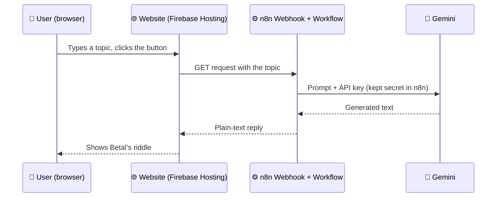

# ☁️ BUILD • AUTOMATE • SHIP

### 🎓 GDG on Campus CU - Cloud Workshop | Student Step-by-Step Guide

> Follow every step. By the end you will have (1) joined **Google Cloud Learn with Communities**, (2) your own **AI-powered website, live on the internet**, with an automation running behind it, and (3) a shot at the title of **Vikramaditya of GDG CU** 👑
>
> **No installs. No credit card. Works on any laptop with Chrome.**

---

## 📋 What You Will Do Today

| Step | Activity | Time |
| ---- | -------- | ---- |
| Step 0 | Pre-flight checklist (do this BEFORE the session) | 10 min, day before |
| Step 1 | Welcome + see the finished product | 0:00 - 0:10 |
| **Part A** | **Google Cloud Learn with Communities** | |
| Step 2 | Make your Google Skills profile public | 0:10 - 0:17 |
| Step 3 | Register with the referral code | 0:17 - 0:25 |
| Step 4 | What happens after you register | 0:25 - 0:30 |
| **Part B** | **The 45-Minute Build** | |
| Step 5 | Meet the architecture (restaurant analogy) | 0:30 - 0:34 |
| Step 6 | Build the doorbell: n8n Webhook | 0:34 - 0:40 |
| Step 7 | Hire the chef: connect Gemini | 0:40 - 0:47 |
| Step 8 | Send the reply + publish + URL-bar test | 0:47 - 0:52 |
| Step 9 | Vibecode the website | 0:52 - 1:02 |
| Step 10 | Wire it up + test on your laptop | 1:02 - 1:06 |
| Step 11 | Deploy to the cloud | 1:06 - 1:15 |
| Step 12 | Show & Tell + n8n in Docker (host demo) | 1:15 - 1:20 |
| **Part C** | **The Betal Round** | |
| Step 13 | Rules of the Betal Round | 1:20 - 1:25 |
| Step 14 | Five tales, five riddles | 1:25 - 1:50 |
| Step 15 | The crowning of Vikramaditya | 1:50 - 1:55 |
| Step 16 | Wrap up + what's next | 1:55 - 2:00 |

---

# STEP 0 - PRE-FLIGHT CHECKLIST

### ⏱ Do this the day before (10 minutes)

> ⚠️ **This is what makes the 45-minute build possible.** Email verification and sign-ups are the slowest part of any online workshop. Do them now, not live.

| # | Task | How | Why |
| - | ---- | --- | --- |
| 1 | Use a **personal Gmail** (not a college/work account) | Switch account in Chrome | College accounts often have AI Studio or Cloud tools blocked by admins |
| 2 | Get a **Gemini API key** | Open [aistudio.google.com](https://aistudio.google.com) → **Get API key** → **Create API key** → copy it into a private note | The key lets n8n talk to Gemini. Google says no billing is needed for the free tier |
| 3 | Create an **n8n Cloud free trial** | Sign up at [n8n.io](https://n8n.io) → start free trial → verify email | 14 days, no credit card |
| 4 | Create a **Firebase project** | [console.firebase.google.com](https://console.firebase.google.com) → **Add project** → name it `betal-yourname` → turn **Google Analytics OFF** → Create | This is where your site will live. Stay on the free **Spark** plan, never click Upgrade |
| 5 | Open your **Google Skills** account | Link is in the mail shared by the organisers | Needed for Part A |
| 6 | Use **Chrome on a laptop** (phone is not enough) | | Everything today runs in the browser |

> 💡 **Do not start the n8n trial a week early.** The 14-day clock starts when you sign up. Your live site depends on it.

### 🔐 Golden Rule of the Day

> **Your API key is your ATM PIN.** It never goes into your website code, never into a screenshot, never into a public GitHub repo. Today you will learn *where it lives instead*.

---

# STEP 1 - WELCOME + SEE THE FINISHED PRODUCT

### ⏱ 0:00 - 0:10

### 📌 What to Do

1. Join the meeting: `<MEET_LINK>`
2. Keep your mic **off**, camera optional
3. In the chat, type: **your name, branch, year, and one thing you want to build someday**
4. Open these tabs now and leave them open:
   - AI Studio · n8n · Firebase console · Google Skills · gemini.google.com
5. Watch the host demo the finished website: type a topic → a ghost answers with a riddle → it is a **real URL on the internet**

### 🧠 Today's Big Idea

A website alone is a poster. A website **plus an automation** is a product.

By the end, your site will *think* because of a workflow you built yourself, and you will have seen the full journey: **idea → backend → website → live URL**.

---

---

# PART A - GOOGLE CLOUD LEARN WITH COMMUNITIES

> 🎁 Free hands-on labs, verifiable Google Cloud skill badges for your resume and LinkedIn, and swag.

| Complete | You earn |
| -------- | -------- |
| 5 skill badges | Official branded **water bottle** |
| 10 skill badges | **Developer Kit with a T-shirt** |
| Any badge | Digital badge for your **resume & LinkedIn** |

> ⏰ **Registrations close on 31 October 2026**, or earlier if seats fill up. Seats are **first-come, first-served**, so we do this first.

---

# STEP 2 - MAKE YOUR GOOGLE SKILLS PROFILE PUBLIC

### ⏱ 0:10 - 0:17

### 📌 What to Do

1. Open **Google Skills** (formerly *Google Cloud Skills Boost*) using the link from the organisers' mail
2. Sign in with your Google account
3. Go to your **profile settings** and set the profile to **Public**
4. **Copy your public profile URL** and paste it in a notepad. You need it in the next step
5. Stuck? The organisers' mail has a step-by-step video for finding your public URL

> ⚠️ **Important:** Only badges earned **during the program timeline** count towards rewards. If you have already done parts of the curriculum, create a **new Google Skills account** and use that one.

### 🧠 Why a Public Profile?

A public profile is a **verifiable portfolio**. Recruiters can open the link and see exactly which labs you completed. It is the difference between *"I know cloud"* and *"here is the proof"*.

---

# STEP 3 - REGISTER WITH THE REFERRAL CODE

### ⏱ 0:17 - 0:25

### 📌 What to Do

1. Open the registration form: `<REGISTRATION_LINK_FROM_MAIL>`
2. Fill in your details and **paste your public Google Skills profile URL**
3. In the **Referral Code** field, enter our chapter code:

```
<GDGoC_CU_REFERRAL_CODE>
```

4. Submit before the deadline

### 🧠 What is a Referral Code?

It is how Google knows **which community brought you in**.

| Without the code | With the code |
| ---------------- | ------------- |
| You register, but GDG CU gets no credit | Your registration and progress count towards **GDG CU's milestones** |

> 💡 Our chapter unlocks swag when **50 students complete 5 badges**, with bigger rewards at 100 and 250. Your code is literally what turns your effort into a team reward.

> ⚠️ **Use only our chapter's code.** Entering another chapter's code credits the wrong community.

---

# STEP 4 - WHAT HAPPENS AFTER YOU REGISTER

### ⏱ 0:25 - 0:30

### 📌 What to Do

1. Check your inbox for a confirmation from the **Google Cloud team**
2. It contains a **unique access code** to unlock free lab credits
3. That email can take **time** to arrive, so don't wait for it. We continue with the workshop
4. Questions about labs later: **learnwithcommunities-support@google.com**

### 🧠 Your 3-Day Badge Plan

| Day | Goal |
| --- | ---- |
| Day 1 | Redeem the access code, finish **1 lab** |
| Day 2-5 | Reach **5 badges** (water bottle zone) |
| Before the deadline | Push for **10 badges** (Developer Kit zone) |

> 🏁 Race the clock: the program is time-bound, and every badge earned today is a badge you don't have to rush later.

---

---

# PART B - THE 45-MINUTE BUILD

# STEP 5 - MEET THE ARCHITECTURE

### ⏱ 0:30 - 0:34

### 🧠 The Whole Project in One Picture

Think of a restaurant:

| In the restaurant | In our project | What it does |
| ----------------- | -------------- | ------------ |
| Menu & counter | **Your website** | What the user sees and clicks |
| Order bell | **Webhook** (n8n) | Rings when an order arrives |
| Kitchen manager | **n8n workflow** | Decides what happens with the order |
| The chef | **Gemini** | Actually creates the answer |
| Staff entry card | **API key** | Proves the kitchen is allowed to use the chef |



> 🔐 **Why this design?** The website never sees the API key. If the key were inside the website, anyone could right-click → View Source and steal it. The **kitchen** holds the key, not the **counter**.

### 🌍 Real Cloud Concept: Regions

Your website is served from Google's global network, close to every visitor. But your n8n instance lives in **one place**: n8n Cloud runs in the **EU (Frankfurt)**. When you click the button, your request travels India → Frankfurt → back. That small pause is **latency**: the exact same idea as picking `asia-south1 (Mumbai)` for Cloud Run.

---

# STEP 6 - BUILD THE DOORBELL: n8n WEBHOOK

### ⏱ 0:34 - 0:40

### 📌 What to Do

1. Open your **n8n** workspace → click **Create workflow** (top right)
2. Click **"Add first step"** → search **Webhook** → select it
3. Set these fields:

| Field | Value |
| ----- | ----- |
| HTTP Method | `GET` |
| Path | `betal` |
| Respond | **Using 'Respond to Webhook' Node** |

4. Open **Options** → **Add option** → **Allowed Origins (CORS)** → type `*`
5. Rename the workflow (top left) to `Betal Bot`

### 🧠 What is a Webhook?

A webhook is a **doorbell for your workflow**. It gives your workflow a public URL. When anything (your website, an app, another service) visits that URL, the bell rings and the workflow runs.

| Without webhooks | With webhooks |
| ---------------- | ------------- |
| You press "Run" by hand | The internet triggers your workflow automatically |

### 🧠 Why GET?

We send the topic in the URL (`...?topic=Cloud Run`). It's the simplest possible way to talk to a backend. No headers, no body, fewer things to break on day one. Real projects often use POST, and that is a great upgrade for later.

### 🧠 What is CORS?

Browsers refuse to let a website on `domain-A` talk to a server on `domain-B` unless domain-B says *"I allow it."* Setting **Allowed Origins** to `*` is you saying *"anyone may call this."* Fine for a demo. In a real product, you would list only your own site.

---

# STEP 7 - HIRE THE CHEF: CONNECT GEMINI

### ⏱ 0:40 - 0:47

### 📌 What to Do

1. Click the **+** after the Webhook node → search **Google Gemini** → choose **Message a model**
2. Under **Credential to connect with** → **Create new credential**
3. Paste your **Gemini API key** → **Save**. Leave the host as default
4. Pick a **Flash** model from the **Model** dropdown
5. In the **Prompt / Message** field, paste this:

```
You are Betal (Vetala) from the Vikram-Betal tales, now a witty ghost who explains tech to college students.
The student gives you a topic. Reply in under 80 words:
1) a tiny spooky-funny story about the topic
2) end with ONE riddle-style question
3) do NOT reveal the answer
Use simple English and at most one emoji. Never include links.
Topic: {{ $('Webhook').item.json.query.topic }}
```

6. Click **Execute step** to test it. You should see Betal's story appear in the output panel on the right

> 💡 If the `{{ ... }}` part shows an error, **delete it and drag the `topic` field** from the left Input panel into the prompt instead. Dragging is always safer than typing paths.

### 🧠 What is an API Key?

It's a **password for a program**. Google gives you one so Gemini knows *who* is calling and how much they have used.

| Rule | Why |
| ---- | --- |
| Never put it in your website | Anyone can read website code |
| Never push it to GitHub | Bots scan GitHub for keys, within minutes |
| If leaked, **delete and recreate it** | A leaked key can't be "un-leaked" |

### 🧠 Free Does Not Mean Unlimited

The Gemini free tier is limited **per project**, not per key, and the exact limits are shown in AI Studio's rate-limit page. If you see a `429` error: you hit the limit. Wait a minute. This is your first real encounter with **quotas**, and every cloud service has them.

> 🔒 **Privacy:** On the free tier, Google may use your requests to improve its products. **Never type personal or private data** into your bot.

---

# STEP 8 - SEND THE REPLY + PUBLISH + URL-BAR TEST

### ⏱ 0:47 - 0:52

### 📌 What to Do

1. Click **+** after the Gemini node → search **Respond to Webhook**
2. Set:

| Field | Value |
| ----- | ----- |
| Respond With | `Text` |
| Response Body | **Drag the generated text field** from the left panel into this box |

3. **Publish the workflow.** In newer n8n it's the **Publish** button, in older versions the **Active** toggle at top right. Until you do this, only the *test* URL works
4. Double-click the **Webhook** node → switch the URL tab to **Production URL** → **copy it**
5. **The URL-bar test:** paste the production URL in a new browser tab and add this at the end:

```
?topic=Cloud Run
```

6. You should see Betal's text on a blank page. 🎉

### 🧠 Test URL vs Production URL

| | Test URL | Production URL |
| - | -------- | -------------- |
| Works when | You click **Listen for test event** | Workflow is **published/active** |
| Shows data in editor | Yes | No |
| Use for | Building | Real visitors |

> ⚠️ **#1 beginner trap:** it works in the editor, but fails from your website → you used the test URL, or forgot to publish.

### 🧠 Why the URL-Bar Test Matters

It splits the problem in half. If the URL-bar test works, **your backend is perfect** and any later bug is in the website. If it fails, don't touch the website yet.

---

# STEP 9 - VIBECODE THE WEBSITE

### ⏱ 0:52 - 1:02

### 🧠 What is Vibecoding?

Vibecoding = you describe the *vibe and behaviour* in plain English, and an AI writes the code. You are the **director**, the AI is the **crew**.

> 💡 Vibecoding doesn't remove the need to understand. It moves your job from *typing code* to *giving precise instructions and checking the result*. The better your prompt, the better your site.

### 📌 What to Do

1. Open **gemini.google.com** or **Google AI Studio** (either works)
2. Paste this prompt:

```
Act as a senior front-end developer who writes beginner-friendly code.
Build a single-file website (index.html, no frameworks, CSS and JS inline) called "Ask Betal".
- Dark spooky-fun theme (deep purple + glowing yellow), big heading, one text box labelled "Give Betal a topic", and a button "Tell me a tale".
- On click: show "Betal is thinking...", then call my backend using
  fetch(WEBHOOK_URL + "?topic=" + encodeURIComponent(topic))
  and read the reply as plain text with response.text().
- Show the reply in a card below. Show a friendly error message if the call fails.
- Put const WEBHOOK_URL = "PASTE_YOUR_N8N_PRODUCTION_URL_HERE"; at the very top of the script.
- NEVER include any API key. Make it mobile friendly.
- Add short comments explaining each part for a first-year student.
Return only the complete code.
```

3. Copy the code → paste into a new file → save as **`index.html`**
4. **Make it yours:** ask the AI for *one change at a time* (a new colour, a bat emoji, a bigger heading)

### 🎨 Prompt Recipe

| Ingredient | Example |
| ---------- | ------- |
| **Role** | "Act as a senior front-end developer" |
| **Task** | "Build a single-file website called Ask Betal" |
| **Constraints** | "No frameworks. Never include an API key" |
| **Style** | "Dark, spooky-fun, mobile friendly" |
| **Output format** | "Return only the complete code" |

### 🛟 Vibecoding Survival Rules

- **One change per message.** Big asks break working code
- If something breaks, **paste the exact error message** back to the AI
- If the AI goes wild → start over with the original prompt
- 🆘 **Totally stuck?** Use the **fallback `index.html`** at the bottom of this guide

---

# STEP 10 - WIRE IT UP + TEST ON YOUR LAPTOP

### ⏱ 1:02 - 1:06

### 📌 What to Do

1. Open `index.html` in a text editor
2. Find this line near the top of the script:

```js
const WEBHOOK_URL = "PASTE_YOUR_N8N_PRODUCTION_URL_HERE";
```

3. Replace the text inside the quotes with your **n8n Production URL** (no `?topic=` part, our code adds it)
4. Save, then **double-click `index.html`** to open it in Chrome
5. Type a topic → click the button → Betal answers 🦇

### 🐞 Something Wrong? Do This First

1. Press **F12** → open the **Console** tab
2. Read the red text, it usually tells you exactly what happened
3. Check the **Common Issues** table at the bottom

### 🧠 What Just Happened?

Your browser (laptop) → called your n8n webhook (Frankfurt) → which called Gemini → and the answer came all the way back. **You built a three-system pipeline.** Most first projects are one system.

---

# STEP 11 - DEPLOY TO THE CLOUD

### ⏱ 1:06 - 1:15

### 📌 What to Do

We will use **Firebase Hosting**, which runs on Google's global network and has a free **Spark plan** that needs **no credit card**.

1. Open **[console.cloud.google.com](https://console.cloud.google.com)** → click the **terminal icon** (top right) to open **Cloud Shell**. Accept any prompt
2. Run these, one block at a time:

```bash
mkdir -p betal-site/public && cd betal-site
```

3. **Upload your file:** Cloud Shell menu **⋮ (More)** → **Upload** → pick `index.html`, then:

```bash
mv ~/index.html public/
echo '{"hosting":{"public":"public"}}' > firebase.json
```

4. **Log in to Firebase** (type `y` if asked to install):

```bash
npx firebase-tools login --no-localhost
```

   Open the link it prints → choose your account → copy the code → paste it back in the terminal

5. **Deploy** (replace `YOUR_PROJECT_ID` with your Firebase **Project ID**, found in Firebase console → ⚙️ **Project settings**. It can differ from the project name):

```bash
npx firebase-tools deploy --only hosting --project YOUR_PROJECT_ID
```

6. When it finishes you will see:

```
Hosting URL: https://YOUR_PROJECT_ID.web.app
```

7. **Click it.** Your site is live. 🎉 Open it on your phone. Send it to a friend.

### 🧠 What is Hosting?

Hosting = renting space on computers that are **always on**, so your site stays up when your laptop is off.

| Your laptop | Firebase Hosting |
| ----------- | ---------------- |
| Site dies when you close the lid | Site stays up 24/7 |
| Only you can open it | Anyone in the world can |
| One location | Served from a **CDN** (copies near every visitor) |

> 💡 **CDN = Amul parlour at every corner.** Instead of everyone travelling to one factory, copies of your site sit close to each user.

### 🆘 Deploy Failed? (Time-box: 5 minutes)

| Problem | Fix |
| ------- | --- |
| `Permission denied` / project not found | You used the project **name**, not the **Project ID** |
| Default Firebase welcome page shows | `index.html` is not inside the `public/` folder → run `ls public` |
| Login code rejected | Run the login command again and use the **new** code |
| Still stuck after 5 minutes | Use the **rescue lane** below |

### 🛟 Rescue Lane (so nobody leaves without a live URL)

Create a GitHub repo → upload `index.html` → **Settings → Pages** → deploy from the main branch. Your site goes live at `https://<username>.github.io/<repo>`.

---

# STEP 12 - SHOW & TELL + n8n IN DOCKER (HOST DEMO)

### ⏱ 1:15 - 1:20

### 📌 What to Do

1. **Paste your live URL in the chat** 🔗
2. Try two other people's sites. Type something silly
3. Watch the host run n8n **on a laptop inside Docker**, no sign-up, no trial, no expiry

### 🧠 Why Is the Host Doing This Live (and Not You)?

Docker needs a heavy install, and we'd rather spend your 45 minutes building. Here's what to notice:

| n8n Cloud (what you used) | n8n in Docker (host demo) |
| ------------------------- | ------------------------- |
| Running in 2 minutes | Needs Docker installed |
| **14-day trial**, then the workspace is deleted unless you pay | **Free to self-host** |
| Has a public URL | Lives on `localhost` |

> 🔮 **Cliffhanger:** a website on the internet cannot call `localhost` on someone's laptop. How do you make a self-hosted n8n reachable, safely, and keep it running forever? **That's our next event: Docker + self-hosting.** Stay tuned in the WhatsApp community. 👀

### ⏳ Your Trial Clock

Your site's automation lives as long as your n8n trial does. Before it ends: **download your workflow** (n8n workflow menu → **Download**). n8n gives you 90 days after the trial ends to do that. Your site will be ready to reconnect when we self-host.

---

---

# PART C - THE BETAL ROUND 🦇

# STEP 13 - RULES OF THE BETAL ROUND

### ⏱ 1:20 - 1:25

### 🎭 The Legend (60 seconds)

> King **Vikramaditya** was told to carry the ghost **Betal** on his back. On the way, Betal told a tale ending with a riddle: *"Raja Vikram, agar tune jawab jaante hue bhi nahi diya, toh tera sar tukde-tukde ho jayega!"*
>
> The king answered correctly every time. Brave? Yes. Wise? The ghost vanished back to the tree each time. You'll see why.

Tonight **I am Betal.** You are **Vikram.** 😈

### 📏 The Rules

| Rule | Detail |
| ---- | ------ |
| 5 tales | Each is a short cloud/dev situation ending in a riddle |
| Silence first | **Nobody answers until Betal says "Vikram, jawab do!"** |
| How to answer | Type **A / B / C / D** in the chat |
| ⚡ Speed bonus | First correct answer = **3 points** |
| ✅ Other correct answers | **1 point** (within 30 seconds of the first) |
| 💀 Betal's Curse | A wrong answer = **-1 point** (you can't go below 0) |
| Tie-break | A sudden-death riddle |

### 🏆 The Prizes

| Rank | Title |
| ---- | ----- |
| 🥇 | **Vikramaditya of GDG CU** |
| 🥈🥉 | **Navratna of the Court** (in the legend, Vikramaditya's court had nine gems 💎) |

Prize: `<REWARD>`

> 🤫 **The tales are secret.** No peeking, no group chats, no asking your AI. Betal knows.

---

# STEP 14 - FIVE TALES, FIVE RIDDLES

### ⏱ 1:25 - 1:50

Five tales. Each one maps to something you did today. Listen carefully: **the trap is always in the story**.

| Tale | Betal's theme | Hidden concept |
| ---- | ------------- | -------------- |
| 1 | The Midnight Biryani | ??? |
| 2 | The Leaked Key | ??? |
| 3 | The Faraway Kitchen | ??? |
| 4 | The Trial That Vanished | ??? |
| 5 | The 2 AM Bug | ??? |

*(Details are revealed live. 😈)*

---

# STEP 15 - THE CROWNING OF VIKRAMADITYA

### ⏱ 1:50 - 1:55

1. Scoreboard revealed
2. Tie-break if needed
3. **Vikramaditya of GDG CU** is crowned. 👑 Screenshot it for LinkedIn

---

# STEP 16 - WRAP UP

### ⏱ 1:55 - 2:00

### 🎓 What You Accomplished Today

| What you did | What it means in the real world |
| ------------ | ------------------------------- |
| Registered in Cloud Learn with Communities | Started a verifiable, resume-ready cloud credential |
| Built an n8n workflow | Built a **backend automation** |
| Connected Gemini with an API key | Integrated an **AI API** and handled a **secret** safely |
| Vibecoded a website | Practised **prompt engineering** for software |
| Deployed on Firebase Hosting | **Shipped to production** on a global CDN |
| Played with quotas, regions and trial limits | Met the **real constraints** of cloud engineering |

### 🚀 What's Next?

1. **Earn your first 5 badges** in Google Skills before the deadline
2. **Remix your bot** (see the challenge below) and post it on LinkedIn with `#GDGonCampus #GoogleCloud`
3. **Join the Docker + self-hosting event.** Your n8n will finally live forever
4. **Level up your deploy skills:** try the [Cloud Run Launchpad guide](https://github.com/Aditya060806/Cloud-deploy-service) from our earlier workshop

---

## 🏆 REMIX CHALLENGE

Your website's personality is **just the prompt in your Gemini node**. Change the prompt and you have a brand-new product.

| Level | Remix idea | How |
| ----- | ---------- | --- |
| 🟢 Easy | **Roast My Idea**: reply with a funny roast of a project idea | Change the prompt in Step 7 |
| 🟢 Easy | **Explain Like I'm in 1st Year** | Prompt: "Explain {topic} in 60 words with a food analogy" |
| 🟡 Medium | Add a **copy button**, a **dark/light toggle**, or a **character limit** | One vibecoding message each |
| 🟡 Medium | Redeploy a new version | `firebase deploy` again, same command |
| 🔴 Hard | Add a **secret header check** so strangers can't spam your webhook | n8n Webhook node → Authentication |
| 🔴 Hard | **Log every question** into a Google Sheet | Add an n8n Google Sheets node |

> 📸 Post your remix link in the community group. Best remix gets a shout-out.

---

## 🛡️ SAFETY CHECK: WHY YOUR WEBHOOK IS PUBLIC

Your webhook URL sits inside your website code, so **anyone can find and call it**. That means anyone can use up your free quota. Today's protections: your **API key is hidden in n8n**, and the free tier has **hard caps**. Real products add authentication, rate limits and monitoring. That's a Cloud Lead's job. 😉

---

## ⚠️ COMMON ISSUES & FIXES

| Problem | Solution |
| ------- | -------- |
| URL-bar test shows "webhook not registered" | Workflow is not **published/active**, or you are on the **Test URL** |
| "...not registered for GET" | Webhook node **HTTP Method** must be `GET` |
| Works in n8n, but website shows an error | Open **F12 → Console**. If you see **CORS**, set **Allowed Origins** to `*` in the Webhook node's Options |
| Reply is empty or says `undefined` | In **Respond to Webhook**, you didn't drag the generated-text field. Redo Step 8 |
| `429` / "quota exceeded" | Free-tier limit. Wait 60 seconds, try another Flash model |
| `403` / "project denied access" | Your Google project or account may be flagged or restricted. Create the key with a **personal Gmail** and check AI Studio |
| "Model not found" | Pick a different **Flash** model from the dropdown |
| Can't open AI Studio | College accounts are often blocked. Switch to personal Gmail |
| n8n verification email didn't arrive | Check spam, wait 2 minutes, request again. Tell the helpers in chat |
| Site loads but button does nothing | You didn't replace `WEBHOOK_URL`, or the URL has a typo |
| Firebase shows the default welcome page | `index.html` isn't in `public/` |
| Someone else's site shows an error | Their n8n workflow may be unpublished. Tell them nicely 😄 |

---

## 🔗 USEFUL LINKS

| Resource | Link |
| -------- | ---- |
| n8n Webhook node docs | <https://docs.n8n.io/integrations/builtin/core-nodes/n8n-nodes-base.webhook/> |
| n8n Cloud free trial | <https://docs.n8n.io/deploy/use-n8n-cloud/start-your-free-trial> |
| n8n Docker install guide | <https://docs.n8n.io> → *Hosting* → *Docker* |
| Google AI Studio (API key) | <https://aistudio.google.com> |
| Gemini API rate limits | <https://ai.google.dev/gemini-api/docs/rate-limits> |
| Firebase pricing (Spark plan) | <https://firebase.google.com/pricing> |
| Cloud Shell docs | <https://cloud.google.com/shell/docs> |
| Cloud Run Launchpad (earlier workshop) | <https://github.com/Aditya060806/Cloud-deploy-service> |
| Cloud Learn support | learnwithcommunities-support@google.com |

---

## 🆘 FALLBACK `index.html`

<details>
<summary>Click only if your vibecoded site refuses to work. Save this as <code>index.html</code>.</summary>

```html
<!DOCTYPE html>
<html lang="en">
<head>
<meta charset="UTF-8">
<meta name="viewport" content="width=device-width, initial-scale=1">
<title>Ask Betal</title>
<style>
  body{margin:0;min-height:100vh;display:grid;place-items:center;background:#1b1033;color:#fff;font-family:system-ui,sans-serif}
  main{width:min(92vw,560px);text-align:center}
  h1{color:#ffd23f;margin-bottom:.2em}
  input,button{font-size:1rem;padding:.8em 1em;border-radius:10px;border:0;margin:.3em}
  input{width:65%}
  button{background:#ffd23f;cursor:pointer;font-weight:700}
  #reply{margin-top:1.2em;padding:1em;background:#2a1a4d;border-radius:12px;text-align:left;white-space:pre-wrap;min-height:2em}
</style>
</head>
<body>
<main>
  <h1>Ask Betal</h1>
  <p>Give me any topic. I will answer with a riddle you cannot forget.</p>
  <input id="topic" placeholder="e.g. Cloud Run, Wi-Fi, exams">
  <button id="go">Tell me a tale</button>
  <div id="reply">Betal is waiting in the dark...</div>
</main>
<script>
  // 1) Paste your n8n PRODUCTION webhook URL below (no ?topic= part)
  const WEBHOOK_URL = "PASTE_YOUR_N8N_PRODUCTION_URL_HERE";

  const topicBox = document.getElementById("topic");
  const reply = document.getElementById("reply");

  document.getElementById("go").addEventListener("click", async () => {
    const topic = topicBox.value.trim();
    if (!topic) { reply.textContent = "Give me a topic first!"; return; }
    reply.textContent = "Betal is thinking...";
    try {
      const res = await fetch(WEBHOOK_URL + "?topic=" + encodeURIComponent(topic));
      if (!res.ok) throw new Error("Server said " + res.status);
      reply.textContent = await res.text();
    } catch (err) {
      reply.textContent = "Betal vanished (" + err.message + "). Check the Common Issues table!";
    }
  });
</script>
</body>
</html>
```

</details>

---

*☁️ Build • Automate • Ship | GDG on Campus Chandigarh University | Cloud Team 2026-27*
